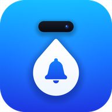

# DropletBanner

**Fluid Dynamic Island & notch liquid droplet animations for native iOS notification banners.**

---

## Overview

**DropletBanner** is a lightweight, standalone iOS SpringBoard tweak that animates incoming notification banners out of the Dynamic Island or notch as a smooth liquid droplet—and retracts them seamlessly back inside on dismiss.

It hooks `SBNotificationBannerDestination` cleanly without replacing or restyling Apple's banner views, preserving your native iOS appearance (including Liquid Glass), preview privacy, sounds, haptics, quick actions, and Long Look gestures.

---

## Features

- **120Hz Liquid Droplet Physics** — A `CADisplayLink`-driven spring animation stretches a fluid teardrop with a curved Bezier neck directly out of the Dynamic Island or notch before blooming into your native notification banner.
- **Dynamic Island Recoil Pulse** — Subtly expands the Dynamic Island cutout on a spring as the droplet detaches and adds a soft "gulp" pulse when the drop retracts back in, with adjustable intensity.
- **Droplet Color Modes (Black / App Icon / Custom)** — Tints only the water drop and gradient liquid neck using the app icon's dominant color or any custom color via iOS's native color picker, while keeping the notification banner itself untouched.
- **Brief Bloom Rim Accent** — Traces a short, luminous highlight around the banner's rounded edge right as the droplet finishes blooming, then fades completely away (customizable thickness and duration).
- **Reversed Retraction on Dismiss** — Retracts notifications smoothly back into the Dynamic Island on both **auto-dismiss** and **swipe-up dismissal**, picking up right where your finger releases the banner.
- **One-Tap Physics Presets** — Switch instantly between **Snappy**, **Liquid**, **Bouncy**, and **Custom** presets, synced live with the Duration and Elasticity sliders.
- **Built-In Live Preview** — Test your exact setup on the spot with the **Test Droplet Animation** button inside Settings (supports both auto-retract and swipe-up dismissal).
- **Neck-Snap Micro-Haptic** — Optional `UIImpactFeedbackGenerator` tick timed to the exact moment the liquid neck detaches or clicks back into the Island (**Soft**, **Light**, **Medium**, or **Rigid**).
- **Rapid-Notification Ready** — Per-banner container isolation and instant handoff keep fast back-to-back notifications smooth with no overlapping visuals or stuck states.
- **Smart Auto-Pause & Per-App Exclusions** — Independently pause the 120Hz animation in **Low Power Mode** or **Landscape**, and exclude specific apps via a searchable **Excluded Apps** list (with real app icons and manual bundle ID entry).
- **Zero Heavy Dependencies** — Pure `UIKit`, `QuartzCore`, `CoreGraphics`, and `Preferences.framework` (no Cephei or external color pickers required), with instant live-reload and zero respringing after changing settings.

---

## Preferences

Configure and preview everything live under **Settings → DropletBanner**:

| Setting | Description | Default |
| :--- | :--- | :---: |
| **Enable Droplet Banner** | Master toggle to enable or disable the tweak instantly. | `On` |
| **Retract on Dismiss** | Plays the reversed droplet retraction on auto-dismiss and swipe-up. | `On` |
| **Test Droplet Animation** | Spawns an interactive preview banner over Settings using your live config. | — |
| **Physics Preset** | One-tap speed & elasticity profile (`Snappy`, `Liquid`, `Bouncy`, `Custom`). | `Liquid` |
| **Animation Duration** | Controls overall entry and retraction speed (`0.25s` – `0.85s`). | `0.48s` |
| **Droplet Elasticity** | Adjusts vertical stretch and liquid bulge intensity (`0.40` – `1.50`). | `1.00` |
| **Droplet Color Mode** | Choose `Black`, `App Icon`, or `Custom` color for the water drop and neck. | `App Icon` |
| **Custom Droplet Color** | Native iOS color picker with live hex swatch (used in `Custom` mode). | `#0A84FF` |
| **Bloom Rim Accent** | Brief edge highlight as the droplet blooms (`Thickness`: `0.8–3.0pt`, `Duration`: `0.20–0.75s`). | `On` (`1.4pt` / `0.38s`) |
| **Island Recoil Pulse** | Spring pulse on the Dynamic Island cutout (`Intensity`: `0.3` – `2.0`). | `On` (`1.0`) |
| **Neck-Snap Micro-Haptic** | Haptic tick on neck detach & retract (`Soft`, `Light`, `Medium`, `Rigid`). | `On` (`Soft`) |
| **Auto-Pause in Low Power Mode** | Automatically bypasses the 120Hz overlay when Low Power Mode is active. | `On` |
| **Auto-Pause in Landscape** | Preserves stock iOS banners in landscape orientation. | `On` |
| **App Exclusions** | Toggle per-app exclusions and manage apps in the searchable **Excluded Apps** list. | `On` (`None`) |
| **Reset to Defaults** | Restores all toggles, sliders, colors, and exclusions cleanly. | — |

---

## Compatibility

- **iOS Versions:** iOS 15.0 and later
- **Jailbreaks:**
  - **RootHide** (`iphoneos-arm64e`)
  - **Rootless** (`iphoneos-arm64`)
- **Devices:** Dynamic Island iPhones, Notched Face ID iPhones, and non-notched fallback

---

## Installation

1. Download the latest `.deb` package from the **[Releases](https://github.com/Billie0x/DropletBanner/releases/latest)** page (or the **Actions → `DropletBanner-debs`** build artifact):
   - **RootHide:** `com.billie.dropletbanner_1.9.0_iphoneos-arm64e.deb`
   - **Rootless:** `com.billie.dropletbanner_1.9.0_iphoneos-arm64.deb`
2. Share or open the `.deb` in **Sileo** or **Zebra** and tap **Install**.
3. Tap **Restart SpringBoard** to activate the tweak.

---
